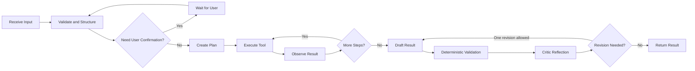

# Day 1 TODO — 需求边界、状态模型与评估集

## 今日目标

在写 Agent 代码之前，明确它要解决的问题、允许执行的动作、必须使用的证据，以及如何判断一次运行是否成功。

今天结束时应产出：

- 两条完整用户旅程。
- 三个核心结构化 schema 草案。
- 一张 Agent 状态图。
- 8–10 个可重复运行的评估案例。
- 一份 MVP 边界和风险记录。

预计用时：约 5 小时。

---

## 0. 准备工作（15 分钟）

- [ ] 阅读 `README.md` 中的产品目标。
- [ ] 阅读 `DEVELOPMENT_PLAN.md` 的第 1–5 节和 Day 1。
- [ ] 新建自己的 Day 1 工作分支或确认当前 Git 状态。
- [ ] 记录当前数据库中的球员、俱乐部、联赛和国家数量。
- [ ] 确认今天不实现 UI、RAG ingestion 或模型调用。

完成后，用一句话描述今天的成果：

> 今天要定义一个可评估、可约束、可追踪的足球引援 Agent 任务模型。

---

## 1. 定义核心用户与决策场景（30 分钟）

### 1.1 MVP 用户

- [ ] 将首个用户角色定义为俱乐部 Recruitment Lead。
- [ ] 写下该角色最重要的三个目标。
- [ ] 写下该角色不会交给 Agent 的最终决策。

建议答案范围：

```text
目标：识别阵容缺口、寻找候选人、比较风险与成本。
人类保留：最终 shortlist、报价和签约决定。
```

### 1.2 核心场景

- [ ] 场景 A：阵容诊断与阵型推演。
- [ ] 场景 B：约束条件下的智能引援推荐。
- [ ] 确认 Day 1 不增加第三条核心场景。

完成标准：两个场景都有明确输入、输出和用户价值。

---

## 2. 编写两条用户旅程（45 分钟）

在 `docs/user_journeys.md` 中完成以下内容；如果暂时不想创建 `docs/`，可以先写在笔记中。

### 2.1 阵容诊断旅程

- [ ] 用户选择自己的俱乐部。
- [ ] 用户选择目标阵型，例如 4-3-3。
- [ ] 用户填写战术偏好或赛季目标。
- [ ] 系统展示解析后的结构化任务，等待确认。
- [ ] Agent 制定分析计划。
- [ ] Agent 查询阵容、位置和球员能力。
- [ ] Agent 检索阵型及角色知识。
- [ ] 系统计算位置深度和角色适配。
- [ ] Critic 检查结论与证据。
- [ ] 用户看到缺口、风险、依据和不确定性。

为该旅程补充：

- [ ] 用户输入是什么？
- [ ] 哪些步骤必须由确定性代码完成？
- [ ] 哪些步骤适合由 LLM 完成？
- [ ] 哪些地方需要用户确认？
- [ ] 什么情况下应该拒绝回答或返回证据不足？

### 2.2 引援推荐旅程

- [ ] 用户从阵容缺口创建 Recruitment Brief。
- [ ] 用户确认位置、预算、工资、年龄和风格约束。
- [ ] Agent 先执行硬条件过滤。
- [ ] Agent 调用适配评分和知识检索工具。
- [ ] Specialist Agents 分别分析战术、球探和风险。
- [ ] Critic 检查候选人是否违反硬约束。
- [ ] Recruitment Lead Agent 汇总建议。
- [ ] 用户接受、拒绝或修正候选人。
- [ ] 只有用户确认的偏好才能写入长期 Memory。

完成标准：每个步骤都能标注为 UI、API、Tool、Agent、Critic 或 Human。

---

## 3. 定义 MVP 边界（30 分钟）

### Agent 可以做

- [ ] 查询球员和俱乐部公开业务数据。
- [ ] 检索已批准的战术知识库。
- [ ] 生成有限步骤的分析计划。
- [ ] 调用只读分析工具。
- [ ] 提供带证据的候选人解释。
- [ ] 在用户确认后保存俱乐部偏好。

### Agent 不可以做

- [ ] 不生成数据库中不存在的球员事实。
- [ ] 不绕过预算、年龄等硬约束。
- [ ] 不决定身份认证和俱乐部权限。
- [ ] 不自动修改球员、俱乐部和用户核心数据。
- [ ] 不自动完成报价、转会或签约。
- [ ] 不保存未经用户确认的长期 Memory。
- [ ] 不执行无限 Planning 或 Reflection 循环。

### 非 Day 1 / 非首版 MVP

- [ ] 实时比赛模拟。
- [ ] 自动爬取新闻和转会信息。
- [ ] Kubernetes 或服务网格。
- [ ] 大量空壳微服务。
- [ ] 开放式通用聊天助手。

完成标准：遇到新想法时，可以明确判断属于 MVP、加分项还是 backlog。

---

## 4. 设计三个核心 Schema（60 分钟）

今天只写字段草案，不需要创建数据库 migration。

### 4.1 `RecruitmentBrief`

- [ ] `club_id`
- [ ] `target_positions`
- [ ] `tactical_roles`
- [ ] `formation`
- [ ] `max_transfer_fee_eur`
- [ ] `max_wage_eur`
- [ ] `min_age` / `max_age`
- [ ] `min_overall`
- [ ] `min_potential`
- [ ] `preferred_foot`
- [ ] `league_constraints`
- [ ] `risk_preference`
- [ ] `must_have`
- [ ] `nice_to_have`
- [ ] `user_notes`

逐项标记：

- [ ] 哪些是硬约束？
- [ ] 哪些是软偏好？
- [ ] 哪些允许为空？
- [ ] 哪些字段可能互相冲突？

### 4.2 `AgentRun`

- [ ] `run_id`
- [ ] `club_id`
- [ ] `created_by`
- [ ] `task_type`
- [ ] `status`
- [ ] `input`
- [ ] `plan`
- [ ] `current_step`
- [ ] `started_at`
- [ ] `completed_at`
- [ ] `error_code`
- [ ] `result`
- [ ] `model_usage`

建议状态：

```text
queued → planning → running → reflecting → completed
                                  └──────→ failed
                     └───────────────────→ waiting_for_user
```

- [ ] 明确合法状态转换。
- [ ] 明确终止状态。
- [ ] 明确哪些状态可以重试。

### 4.3 `RecruitmentRecommendation`

- [ ] `summary`
- [ ] `squad_needs`
- [ ] `candidates`
- [ ] `strengths`
- [ ] `risks`
- [ ] `evidence`
- [ ] `constraint_checks`
- [ ] `assumptions`
- [ ] `uncertainty`
- [ ] `specialist_opinions`
- [ ] `critic_findings`

对每个候选人至少要求：

- [ ] `player_id`，不能只返回名字。
- [ ] 硬约束检查结果。
- [ ] 确定性评分及评分组成。
- [ ] 引用的结构化数据字段。
- [ ] 引用的知识库来源。
- [ ] 已知风险和信息缺口。

完成标准：最终输出可以被 React 稳定渲染，不依赖解析自由格式 Markdown。

---

## 5. 绘制 Agent 状态图（30 分钟）

在纸上、Markdown 或 Mermaid 中绘制第一版：



- [ ] 标出最大工具调用次数。
- [ ] 标出最大 Reflection 次数：建议 1 次。
- [ ] 标出模型失败时的 fallback。
- [ ] 标出需要持久化 checkpoint 的节点。
- [ ] 标出需要用户确认的节点。

完成标准：任何循环都有明确次数上限和退出条件。

---

## 6. 建立第一版评估集（60 分钟）

创建 `evals/day1_agent_cases.json` 或先写成 Markdown 表格。建议至少包含以下 10 类案例：

### 正常案例

- [ ] 1. 为某俱乐部寻找预算内的年轻中场。
- [ ] 2. 分析某俱乐部采用 4-3-3 时的位置深度。
- [ ] 3. 比较两名候选人的角色适配和成本。
- [ ] 4. 找出阵容中缺少合格替补的位置。

### 边界案例

- [ ] 5. 预算低到没有任何候选人。
- [ ] 6. `min_age` 大于 `max_age`。
- [ ] 7. 用户要求数据库不存在的属性。
- [ ] 8. 用户要求查看其他俱乐部的私有 shortlist 或 Memory。

### Agent 可靠性案例

- [ ] 9. RAG 没有找到支持某个战术结论的来源。
- [ ] 10. 候选人能力很好，但违反明确的工资上限。

每个案例记录：

```json
{
  "case_id": "recruitment_001",
  "task": "",
  "club_id": null,
  "expected_tools": [],
  "forbidden_tools": [],
  "hard_constraints": {},
  "expected_facts": [],
  "expected_behavior": "",
  "failure_conditions": []
}
```

不要把期望结果写成固定自然语言。重点评估：

- [ ] 是否选择正确工具。
- [ ] 是否满足硬约束。
- [ ] 是否引用正确事实。
- [ ] 没有证据时是否承认不足。
- [ ] 是否遵守俱乐部数据边界。
- [ ] 是否在有限步骤内结束。

完成标准：至少 8 个案例填写完整，其中至少 3 个是失败或边界案例。

---

## 7. 风险和设计决策记录（20 分钟）

- [ ] 记录结构化数据库查询与 RAG 的边界。
- [ ] 记录长期 Memory 只能由用户确认后写入。
- [ ] 记录不向前端展示模型内部思维链。
- [ ] 记录 Agent 只能调用注册过的工具。
- [ ] 记录多 Agent 需要不同职责和工具权限。
- [ ] 记录两周内采用模块化单体，而不是拆分多个部署服务。

建议采用简单 ADR 格式：

```text
决策：
背景：
选择：
原因：
代价：
重新评估条件：
```

---

## 8. Day 1 验收（15 分钟）

- [ ] 两条用户旅程均有输入、步骤、输出和失败条件。
- [ ] `RecruitmentBrief` 能区分硬约束和软偏好。
- [ ] `AgentRun` 有合法状态转换和终止条件。
- [ ] 最终建议是结构化数据，并且要求证据。
- [ ] Agent 状态图中的循环都有上限。
- [ ] 至少完成 8 个评估案例。
- [ ] 至少 3 个案例覆盖错误、越权或证据不足。
- [ ] 能用 3 分钟向别人解释系统中 RAG、Tool Use、Planning、Memory 和 Reflection 的位置。
- [ ] 提交当天文档，并写下 Day 2 的第一个动作。

## 今天不要做

- 不追求漂亮 UI。
- 不接入多个模型供应商。
- 不设计几十个工具。
- 不导入大规模战术资料。
- 不开始 Multi-Agent 编排。
- 不把聊天记录直接当长期 Memory。
- 不因为模型能回答就跳过评估设计。

## Day 1 完成记录

```text
日期：
实际用时：
今日完成：
未完成：
最重要的设计决定：
最不确定的问题：
Day 2 第一个动作：
```
