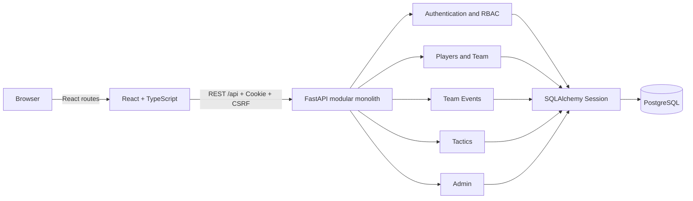
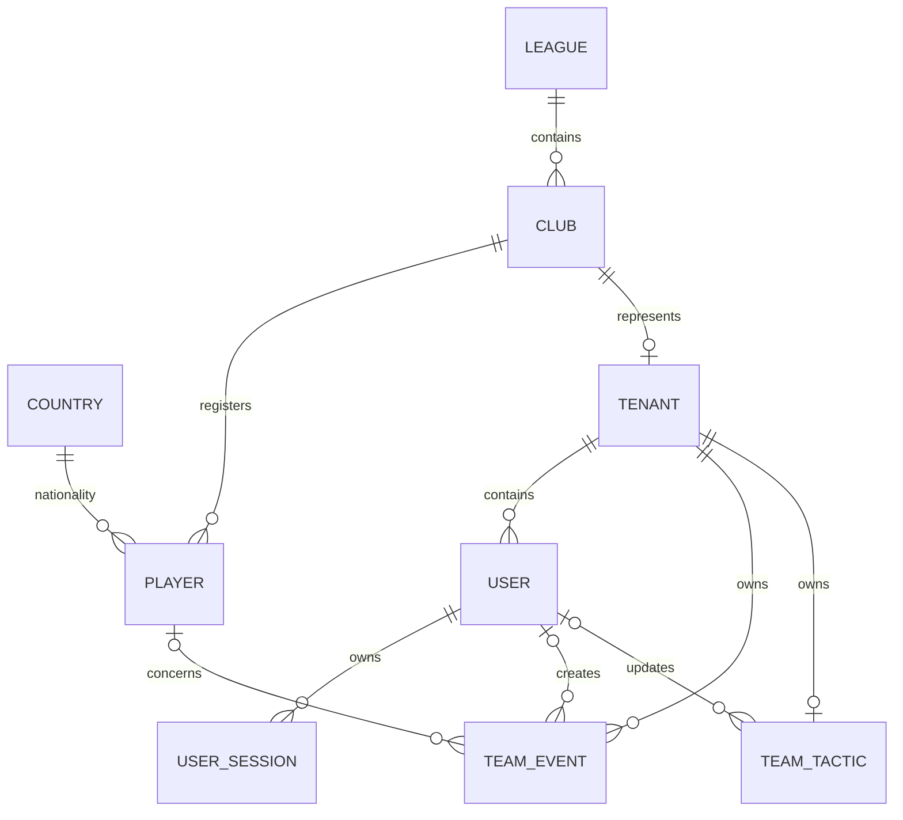
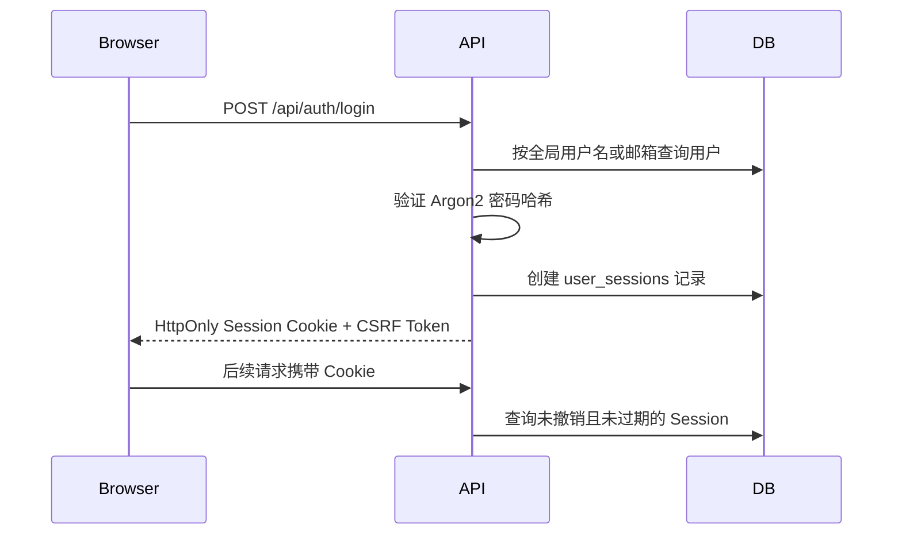

# Football Recruitment Hub 详细设计

> 文档状态：当前 Agent 采用代码配置，不再使用 Agent Definition Registry；轻量 Runtime、只读业务 Tool、短期 Memory、足球知识检索与 Web 招募分析入口已实现。

## 1. 产品定位

本项目是面向足球俱乐部的球员市场与招募辅助 Web 应用。当前阶段先建立可靠的业务底座：用户登录后可查看本队阵容、浏览外部球员、查看球员详情、维护球队事件和当前战术。

产品最终会在这些确定性业务数据之上增加 Embedded Recruitment Agent，但 Agent 不作为通用聊天机器人，也不负责权限、筛选、计算或工作流状态。

### 1.1 当前目标

- 以俱乐部为租户隔离用户和业务数据。
- 提供类似电商目录的球员浏览体验。
- 为后续阵容诊断、球员推荐和知识库检索准备结构化上下文。
- 让经理、教练、球员和队医拥有符合职责的操作权限。
- 保持单体部署简单，同时按业务模块组织代码。

### 1.2 当前非目标

- 不支持一个用户加入多个俱乐部。
- 不支持同一租户下的一线队、预备队和青年队分组。
- 不支持多套战术、战术历史或可拖拽战术板。
- 不包含真实转会决策、合同谈判、财务审批或球探工作流。
- 不包含 Agent、RAG、向量数据库或模型调用。

## 2. 总体架构

项目采用前后端分离的模块化单体架构：



### 2.1 技术栈

| 层级 | 当前技术 |
|---|---|
| 前端 | React、TypeScript、React Router、Vite、原生 CSS |
| API | FastAPI、Pydantic |
| 持久化 | PostgreSQL、SQLAlchemy 2.x、psycopg |
| 数据库迁移 | Alembic |
| 密码安全 | pwdlib 推荐算法，目前为 Argon2 |
| 测试 | pytest、HTTPX、SQLite 内存数据库 |
| 本地编排 | Makefile |

### 2.2 为什么使用模块化单体

所有业务模块运行在同一个 FastAPI 进程并共享一个数据库，但每个模块拥有自己的 API、模型、Schema 和业务规则。该方案避免早期微服务带来的网络、部署、事务和可观测性成本，同时为未来拆分高耗时 AI 任务保留清晰边界。

## 3. 代码结构

```text
backend/
  app/
    main.py                    # FastAPI 创建与路由注册
    config.py                  # 环境配置
    shared/database.py         # Engine、Session、Base
    modules/
      auth/                    # 登录、Session、CSRF、租户与角色
      admin/                   # 租户内用户管理
      players/                 # 球员查询、详情、评分脱敏
      team/                    # 当前租户阵容
      events/                  # 医疗、训练、更衣室事件
      tactics/                 # 当前战术
      health/                  # 健康检查
  migrations/                 # Alembic 迁移
  tests/                       # 后端测试

frontend/
  src/
    api/                       # REST 请求与响应类型
    auth/                      # 登录状态、路由保护、球队主题
    components/                # AppShell、PlayerCard 等复用组件
    pages/                     # 页面级组件
    utils/                     # 搜索归一化等纯函数
    App.tsx                    # 前端路由表
    styles.css                 # 全局样式与响应式规则

scripts/
  manage_tenants.py            # 租户 CRUD
  mock_arsenal_events.py       # 阿森纳事件 mock
  normalize_players.py         # 数据导入与归一化
```

## 4. 多租户模型

### 4.1 租户边界

- 一个 `Tenant` 唯一对应一个 `Club`。
- 一个租户可以包含多个用户。
- 一个用户只能属于一个租户。
- 用户名在整个系统全局唯一，因此登录时不需要输入租户 ID。
- 球员、俱乐部、联赛和国家是共享参考数据，不为每个租户复制。
- 球队事件、当前战术、用户和 Session 是租户相关数据。

### 4.2 核心数据关系



### 4.3 租户隔离实现原则

业务 API 不接受客户端提交的 `tenant_id`。后端从已认证用户的 Session 中获得 `user.tenant_id`，并将其加入查询或写入条件。例如：

```python
select(TeamEvent).where(
    TeamEvent.id == event_id,
    TeamEvent.tenant_id == user.tenant_id,
)
```

管理员只能管理同租户用户。租户本身的增删改查只通过服务器脚本执行，不暴露 Web API。

## 5. 数据库设计

### 5.1 共享足球数据

#### `countries`

- `nationality_id`：主键
- `nationality_name`：国家名称

#### `leagues`

- `league_id`：主键
- `league_name`：联赛名称

#### `clubs`

- `club_team_id`：主键
- `club_name`：俱乐部名称
- `league_id`：外键，指向 `leagues`

#### `players`

以 `player_id` 为主键，保存身份、注册俱乐部、国家、身体信息、经济数据、综合评分、详细能力值和位置评分。当前数据源为 FC26，但 API 和租户模型不依赖某一个具体俱乐部。

### 5.2 身份与租户数据

#### `tenants`

- `id`：主键
- `name`、`slug`
- `club_team_id`：唯一外键，一个俱乐部最多对应一个租户
- `is_active`
- `created_at`、`updated_at`

#### `users`

- `tenant_id`：所属租户
- `username`、`username_normalized`：展示值与全局唯一归一化值
- `email`、`email_normalized`
- `password_hash`：只保存密码哈希
- `role`：PostgreSQL `user_role` 枚举
- `is_active`、`last_login_at`

#### `user_sessions`

- `token_hash`：Cookie 原始 Token 的 SHA-256 哈希
- `csrf_token`：状态变更请求使用的 CSRF Token
- `expires_at`、`revoked_at`
- `user_agent`、`ip_address`

数据库不保存浏览器 Cookie 中的原始 Session Token。

### 5.3 球队事件

`team_events` 使用 `tenant_id` 隔离，包含三类事件：

| 类型 | 必填业务字段 |
|---|---|
| Medical | 球员、受伤日期、描述、恢复天数 |
| Training | 球员、事件日期、训练项目、效果分数 |
| Dressing room | 事件日期、描述 |

训练效果分数由 API 与数据库共同约束为 `0–10`。医疗事件复出日期不冗余存储，而是根据 `injury_date + recovery_days` 自动计算。

### 5.4 当前战术

`team_tactics` 通过 `tenant_id` 唯一约束保证每个租户最多拥有一份当前战术：

- `formation`
- `playing_style`
- `notes`
- `updated_by_user_id`
- `created_at`、`updated_at`

当前采用覆盖更新，不保存历史版本。

### 5.5 PostgreSQL 枚举

| 类型 | 值 |
|---|---|
| `user_role` | `manager`、`player`、`doctor`、`coach` |
| `team_event_type` | `medical`、`training`、`dressing_room` |
| `formation` | `4-3-3`、`4-2-3-1`、`4-4-2`、`3-4-3`、`3-5-2`、`5-3-2` |
| `playing_style` | `possession`、`counter_attack`、`high_press`、`low_block`、`wing_play`、`direct`、`balanced` |

## 6. 认证与安全设计

### 6.1 登录流程



无论用户名不存在还是密码错误，接口都返回相同的 401 信息，并使用 dummy hash 降低用户名枚举带来的时序差异。

### 6.2 Session Cookie

- `HttpOnly`：前端 JavaScript 无法读取 Session Token。
- `SameSite=Lax`：降低跨站请求风险。
- `Secure`：由环境变量控制，生产 HTTPS 环境应启用。
- 服务端仅保存 Token 哈希，并检查过期、撤销、用户状态和租户状态。

### 6.3 CSRF 防护

POST、PUT、PATCH、DELETE 等状态变更请求必须：

1. 携带有效 Session Cookie；
2. 在 `X-CSRF-Token` 请求头中提供当前 Session 的 CSRF Token；
3. 当存在 `Origin` 时，来源必须位于允许的前端地址列表中。

### 6.4 密码和账号规则

- 新密码至少 8 个字符。
- 用户名为 3–50 个字符，只允许字母、数字、下划线、点和连字符。
- 管理员不能禁用或删除自己。
- 管理员修改密码会撤销目标用户除当前操作 Session 外的其他有效 Session。
- 禁用用户时撤销该用户全部有效 Session。

## 7. 角色权限

| 能力 | Manager | Coach | Player | Doctor |
|---|:---:|:---:|:---:|:---:|
| 查看阵容和球员市场 | ✓ | ✓ | ✓ | ✓ |
| 查看球员详情 | ✓ | ✓ | ✓ | ✓ |
| 查看全部球队事件 | ✓ | ✓ | ✓ | ✓ |
| 新增/修改医疗事件 | ✓ |  |  | ✓ |
| 新增/修改训练事件 | ✓ | ✓ |  |  |
| 新增/修改更衣室事件 | ✓ | ✓ | ✓ |  |
| 删除球队事件 | ✓ |  |  |  |
| 查看当前战术 | ✓ | ✓ | ✓ | ✓ |
| 修改当前战术 | ✓ | ✓ |  |  |
| 管理租户内用户 | ✓ |  |  |  |

前端隐藏无权限入口只是改善体验；最终权限始终由 FastAPI 依赖和业务校验在服务端执行。

## 8. 后端模块设计

### 8.1 分层约定

- `api.py`：HTTP 路由、依赖注入、状态码与响应组装。
- `schemas.py`：Pydantic 请求/响应契约。
- `models.py`：SQLAlchemy 数据模型与关系。
- `repository.py`：可复用查询和分页逻辑。
- `service.py`：与 HTTP 和持久化相对独立的业务规则。

当前各模块规模较小，并非每个模块都机械包含所有层。

### 8.2 球员查询

Marketplace 使用数据库分页查询：

- 按 `overall DESC, player_id` 稳定排序；
- 支持姓名的 PostgreSQL `unaccent` 模糊搜索；
- 支持位置筛选；
- 自动排除当前租户俱乐部内的球员，但保留自由球员；
- 返回 `page`、`page_size`、`total` 和 `pages`。

浏览器宽度决定 `page_size`，页码、姓名和位置筛选写入 URL 查询参数，进入详情后返回可恢复原浏览状态。

### 8.3 球员评分脱敏

数据库保留真实评分，Repository 仍可用真实评分排序；API 响应层通过 `ratings.py` 转换后才返回前端：

| 原始数值 | API 等级 |
|---|---|
| `< 50` | D |
| `50–64` | C |
| `65–74` | B |
| `75–84` | A |
| `>= 85` | A+ |

OVR、POT、详细 0–100 能力值和位置评分均执行该转换。位置值如 `84+1` 先计算最终值，再映射为等级。年龄、身价、工资和 1–5 级属性不使用该规则。

### 8.4 阵容查询

阵容接口从当前用户租户取得 `club_team_id`，仅查询该俱乐部注册球员，并按真实 OVR 降序排列。响应中的评分仍经过统一脱敏 Schema。

### 8.5 球队事件校验

事件写权限由事件类型与用户角色共同决定。后端还会验证：

- 事件只包含该类型允许的字段；
- 所有必填字段存在；
- 医疗和训练事件关联的球员属于当前租户俱乐部；
- 恢复天数非负；
- 训练效果分数在 0–10 内。

### 8.6 当前战术 Upsert

`PUT /api/tactics/current` 查询当前租户记录：不存在则创建，存在则覆盖。客户端不能指定租户或修改人，后端分别取自当前认证用户。

## 9. REST API

所有业务接口以 `/api` 为前缀。

### 9.1 Auth

| Method | Path | 说明 |
|---|---|---|
| POST | `/auth/login` | 用户名或邮箱登录 |
| GET | `/auth/me` | 恢复当前用户与 CSRF Token |
| POST | `/auth/logout` | 撤销当前 Session |

### 9.2 Players and team

| Method | Path | 说明 |
|---|---|---|
| GET | `/players` | Marketplace 分页、搜索和筛选 |
| GET | `/players/{player_id}` | 球员详细资料 |
| GET | `/team/squad` | 当前租户球队阵容 |

### 9.3 Events

| Method | Path | 说明 |
|---|---|---|
| GET | `/events` | 按类型查询当前租户事件 |
| POST | `/events` | 按角色创建事件 |
| PATCH | `/events/{event_id}` | 按角色修改事件 |
| DELETE | `/events/{event_id}` | 经理删除事件 |

### 9.4 Tactics

| Method | Path | 说明 |
|---|---|---|
| GET | `/tactics/current` | 查看当前租户战术；未设置时返回空字段 |
| PUT | `/tactics/current` | 经理或教练创建/覆盖当前战术 |

### 9.5 Admin

| Method | Path | 说明 |
|---|---|---|
| GET | `/admin/users` | 查询同租户用户 |
| POST | `/admin/users` | 创建同租户用户 |
| PATCH | `/admin/users/{id}` | 启用或禁用用户 |
| DELETE | `/admin/users/{id}` | 删除非当前用户 |
| PATCH | `/admin/users/{id}/password` | 修改用户密码 |

## 10. 前端设计

### 10.1 路由

| Path | 页面 |
|---|---|
| `/login` | 登录 |
| `/squad` | 当前球队阵容 |
| `/marketplace` | 球员市场 |
| `/players/:playerId` | 球员详情 |
| `/events` | 球队事件 |
| `/tactics` | 当前战术 |
| `/admin/users` | 用户管理，仅经理 |

`ProtectedRoute` 负责登录态路由保护和经理页面保护。`AuthContext` 在应用启动时调用 `/auth/me` 恢复用户、租户和 CSRF 状态。

### 10.2 AppShell

- 左侧固定导航，可展开和折叠。
- 折叠状态写入 `localStorage`。
- 导航根据角色显示 Accounts 入口。
- 页面主题根据当前租户对应的俱乐部自动选择。
- 未预设俱乐部使用中性主题。

### 10.3 PlayerCard

阵容与 Marketplace 共用球员卡片。卡片支持鼠标和键盘进入详情；当用户正在拖动选择卡片文字时不触发跳转。头像边框颜色按球员位置组区分，但 OVR/POT 标签使用俱乐部主题色。

### 10.4 响应式设计

- 球员网格根据视口从四列逐步降为一列。
- Marketplace 根据视口动态选择每页数量。
- 账户、事件、详情和战术布局在窄屏下切换为单列。
- 小屏幕导航固定使用窄折叠布局。

### 10.5 战术预览

阵型字符串被解析成多条阵线，例如 `4-2-3-1` 映射为后卫、中场与前锋位置点。预览仅表达结构，不绑定具体球员，也不支持拖拽。

## 11. 配置和运行

配置由 `backend/app/config.py` 从项目根目录 `.env` 读取。文档只记录变量名，不应提交实际密钥：

```dotenv
DATABASE_URL=
MULTITENANT_DATABASE_URL=
FRONTEND_ORIGIN=http://localhost:5173
SESSION_COOKIE_NAME=recruitment_session
SESSION_LIFETIME_HOURS=24
COOKIE_SECURE=false
```

当设置 `MULTITENANT_DATABASE_URL` 时，应用优先使用它；否则使用 `DATABASE_URL`。

常用命令：

```bash
make setup
make migrate
make dev
make test
make build
make tenant ARGS='list'
```

## 12. 数据库迁移与脚本

数据库结构变更只能通过 Alembic 迁移推进。当前 head 为：

```text
20260826_0010
```

租户操作通过以下脚本完成：

```bash
PYTHONPATH=backend .venv/bin/python scripts/manage_tenants.py list
PYTHONPATH=backend .venv/bin/python scripts/manage_tenants.py create ...
PYTHONPATH=backend .venv/bin/python scripts/manage_tenants.py update ...
PYTHONPATH=backend .venv/bin/python scripts/manage_tenants.py delete ...
```

阿森纳事件 mock 脚本支持先验证再写入：

```bash
PYTHONPATH=backend .venv/bin/python scripts/mock_arsenal_events.py --dry-run
PYTHONPATH=backend .venv/bin/python scripts/mock_arsenal_events.py
```

## 13. 测试策略

当前后端测试覆盖：

- 登录、Session 和账号权限；
- 多租户用户管理；
- 球员搜索、分页顺序、阵容和 Marketplace 排除本队；
- 球队事件权限与租户隔离；
- 训练效果边界；
- 评分等级边界；
- 战术权限与租户隔离。

测试使用 SQLite 内存数据库提高执行速度。PostgreSQL 专属能力，例如 `unaccent` 和原生枚举迁移，还需要通过本地 PostgreSQL 迁移与集成验证。

前端当前以 TypeScript 编译和 Vite production build 作为基础验证，尚未引入组件测试或端到端测试框架。

## 14. 已知限制

- 前后端字符串联合类型与后端/数据库枚举仍需人工同步。
- 球员评分虽然不会由 API 返回，但 Marketplace 排序仍可能透露相对强弱。
- 用户禁用、密码修改与 Session 撤销依赖每次请求查询 Session，没有额外缓存。
- 当前没有审计日志，无法完整回答谁在何时修改或删除了某条记录。
- 事件列表只有基础 limit/offset，尚无前端分页。
- 战术只有当前版本，没有历史记录或比赛维度。
- 没有自动化前端测试、性能测试和生产部署配置。

## 15. Agent Service 当前实现与扩展边界

后续 Agent 应作为现有确定性系统的消费者和建议层，而不是替代现有模块。推荐的集成顺序是：

1. 定义只读工具接口：读取阵容、战术、事件和候选球员。
2. 建立足球知识库与可追溯检索结果。
3. 生成结构化阵容诊断，附证据、假设和不确定性。
4. 使用确定性过滤先缩小候选集，再由模型解释和辅助排序。
5. 将建议展示在阵容、战术或 shortlist 的关键节点，而不是开放通用对话能力。

Agent 不应直接绕过 API 权限读取其他租户，也不应直接提交删除、用户管理或不可逆操作。所有模型输出都应被视为不可信输入并经过结构校验。

当前 Agent Service 已实现：

- `AgentRunner` 的模型调用、Tool Calling、步数/次数/超时限制、结构化校验与降级；
- 通过服务间 API 读取阵容、战术、伤病和确定性候选球员，Backend 重建用户身份并执行租户隔离；
- `ConversationThread`、`ConversationMessage` 和版本化 `ThreadSummary`；
- 基于 `thread.revision` 的乐观并发控制，以及“滚动摘要 + 连续最近消息”的上下文裁剪；
- Recruitment Prompt、Tool 白名单和输出 Schema 直接由代码定义；版本常量仅用于轨迹标识；
- Thread 创建时记录当前代码版本，不需要预先注册或启用 Agent。
- 基于 PostgreSQL + pgvector 保存足球知识文档与 1024 维片段向量，默认通过本机 Ollama 使用 `bge-m3`，并执行固定余弦检索和租户可见性条件；
- 将知识检索注册为 `search_football_knowledge` Tool，并通过结构化 Evidence 连接阵容、事件、球员与知识片段来源；
- 候选球员继续由 Backend 确定性筛选，LLM 只负责结合知识片段解释适配原因、风险与不确定性。

Agent Service 数据库迁移命令：

```bash
make migrate-agent
```

服务间通信需要 Backend 与 Agent Service 使用相同的 `AGENT_SERVICE_TOKEN`。真实密钥只通过环境变量提供。

知识向量迁移要求 PostgreSQL 服务器已安装 pgvector 扩展；Python 的 `pgvector` 包不能代替服务器扩展。知识导入示例：

```bash
make knowledge ARGS='path/to/football_knowledge.md'
```
